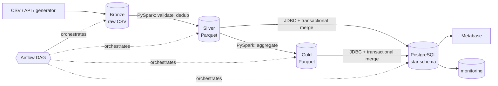
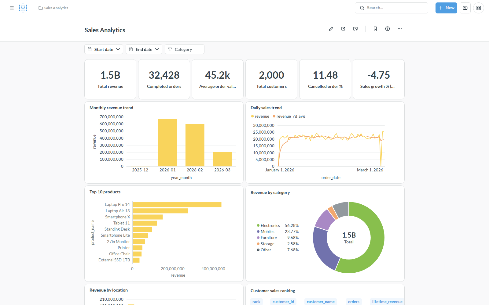
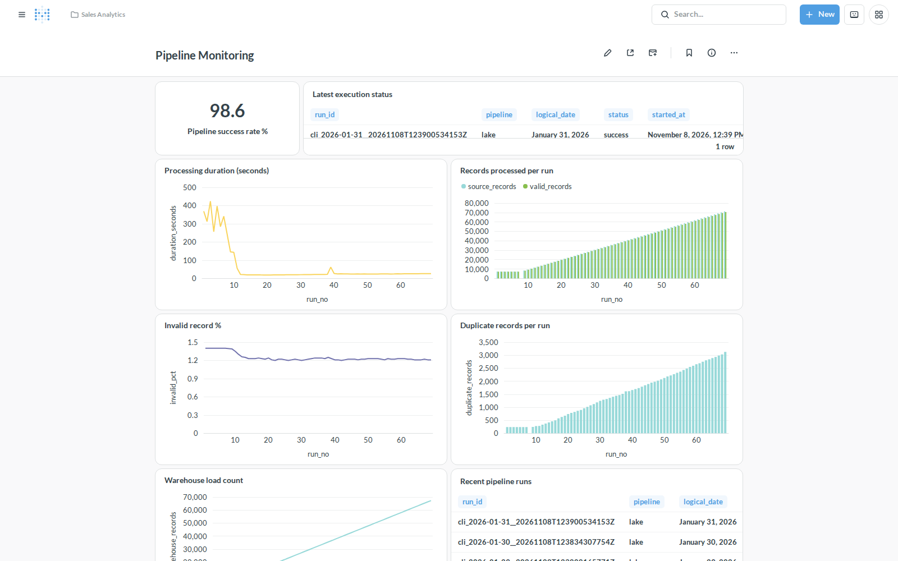
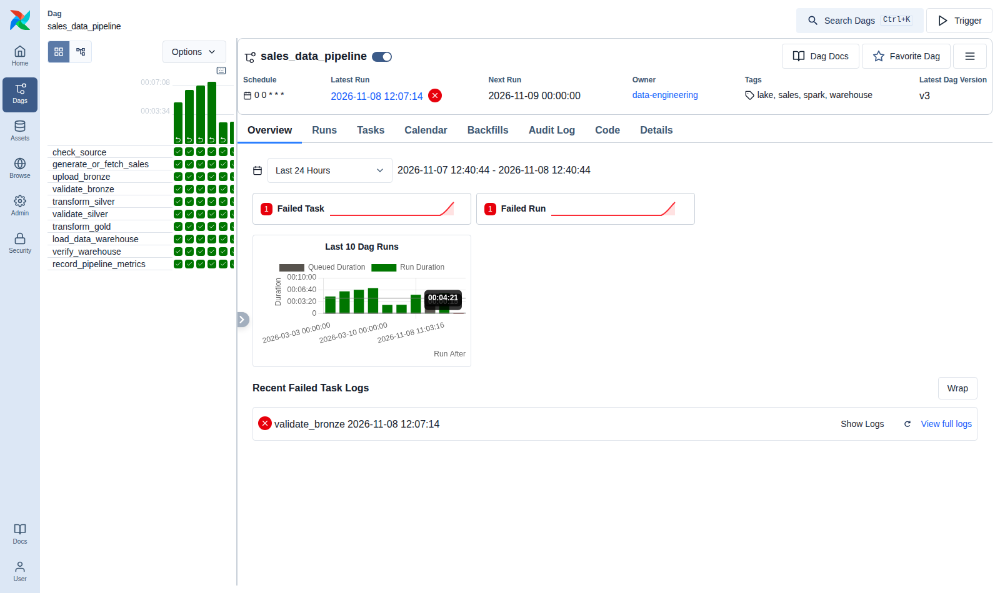
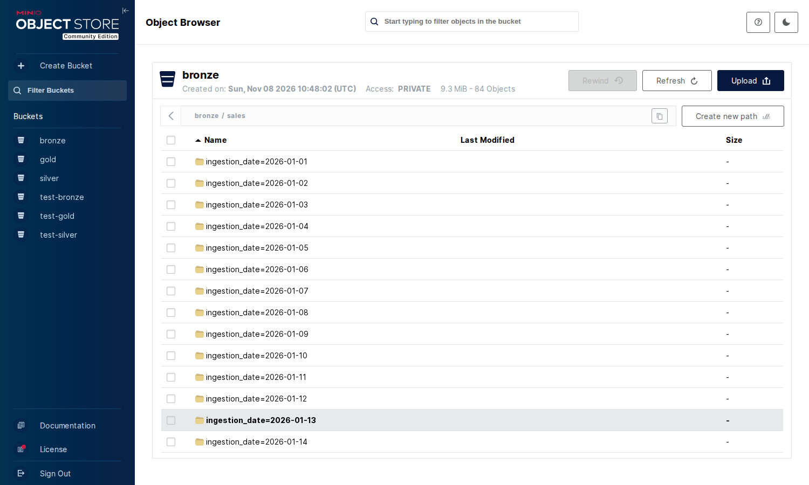

# End-to-End Sales Data Engineering Pipeline

A complete, local, production-style data platform for sales transactions:

**CSV / REST API → Python ingestion & validation → MinIO data lake (Bronze / Silver / Gold) → PySpark →
PostgreSQL star schema → Metabase dashboards**, orchestrated by **Apache Airflow**, with data-quality
gates, idempotent re-runs, monitoring tables and automated tests. Everything runs with Docker
Compose on one machine — no cloud account needed.



New here? Start with **[How it works (plain-language guide and FAQ)](docs/HOW_IT_WORKS.md)**.

Detailed docs: [Architecture](docs/ARCHITECTURE.md) · [Data model](docs/DATA_MODEL.md) ·
[PySpark guide](docs/PYSPARK_GUIDE.md) · [Benchmark](docs/benchmark_results.md) ·
[Interview guide](docs/INTERVIEW_GUIDE.md) · [Project overview](docs/PROJECT_OVERVIEW.md) ·
[Verification report](docs/VERIFICATION_REPORT.md) ·
[Production readiness](docs/PRODUCTION_READINESS.md) ·
[Deploy on AWS (EC2 + S3)](docs/DEPLOY_AWS.md)

## Features

* **Synthetic data generator** — streaming, seeded, 1k to 1M+ rows; multi-line orders, discounts,
  payment methods, locations, order-status updates; optional dirty test cases (duplicates, missing
  values, bad quantities/prices/dates/statuses, total mismatches, messy formats).
* **Validation contract** with 11 ordered reject rules, implemented identically in **pandas** and
  **PySpark** (parity is tested row by row).
* **Medallion lake on MinIO** — Bronze (raw + metadata + checksums), Silver (typed, de-duplicated,
  partitioned Parquet + quarantine), Gold (6 aggregate tables); immutable versions published by
  pointer swap.
* **PostgreSQL warehouse** — `raw`, `staging`, `mart`, `monitoring` schemas, versioned migrations,
  star schema (4 dimensions + fact at order-line grain), SCD Type 1, constraints, indexes,
  guarded idempotent upserts, advisory locks.
* **Airflow 3 DAG `sales_data_pipeline`** — 10 real tasks, daily data-interval schedule, manual
  runs, backfills, retries with back-off, timeouts, quality gates, failure callback/webhook,
  batch quarantine.
* **Monitoring** — run/task metrics, batch registry, data-quality results in PostgreSQL.
* **Metabase** — read-only DB user; *Sales Analytics* (12 cards, date + category filters) and
  *Pipeline Monitoring* (9 cards) dashboards provisioned by API.
* **Benchmark** — reproducible Pandas vs PySpark comparison at 10k / 100k / 1M rows.
* **Tests** — pytest unit + integration (warehouse, MinIO, Spark parity, end-to-end lake, DAG).

## Technology stack

| Area | Technology (version) |
|---|---|
| Language | Python 3.12 (in Docker) |
| Warehouse | PostgreSQL 16 |
| Ingestion | Python, pandas 2.3, psycopg 3 |
| Data lake | MinIO (S3 API), boto3 |
| Formats | CSV, JSON Lines, Apache Parquet (pyarrow 18) |
| Processing | Apache Spark / PySpark 4.1.1 (Java 17, hadoop-aws 3.4.2) |
| Orchestration | Apache Airflow 3.1.8 (LocalExecutor) |
| Analytics | Metabase v0.64 (LTS line) |
| Containers | Docker, Docker Compose |
| Testing | pytest |

## Prerequisites

* Docker Desktop (or Docker Engine) with Compose v2, about **8 GB RAM** allocated to Docker, about 6 GB of disk.
* Python 3 on the host, **only** to run `scripts/setup_env.py` (any version; standard library only).
  Everything else runs in containers, so Java or Spark are not needed on the host.

## Quick start

```powershell
# Windows PowerShell (macOS/Linux: identical commands, or ./scripts/initialize.sh)
python scripts/setup_env.py          # creates .env with random secrets (never committed)
docker compose build                 # one image: Airflow + PySpark + Java + connectors (~10 min first time)
docker compose up -d                 # postgres, minio, init, airflow, metabase, mock-api
docker compose ps                    # wait until services are healthy (~1-2 min)
```

`init` applies the SQL migrations, creates the read-only reporting role and the lake buckets.

### 1. Generate data

```bash
docker compose run --rm app python -m src.cli generate --records 10000 --dirty-rate 0.02 --output data/generated/sales_10k.csv
# sizes: --records 1000 | 10000 | 100000 | 1000000 ; --seed N ; --format jsonl ; --daily 2026-03-01
```

### 2a. Warehouse-only pipeline (Phase 1: pandas → PostgreSQL)

```bash
docker compose run --rm app python -m src.cli ingest --input data/sample/sales_sample.csv
docker compose run --rm app python -m src.cli ingest --input data/sample/sales_sample.csv   # re-run: no changes
docker compose run --rm app python -m src.pipeline --input data/sample/legacy_phase1_sales.csv   # original starter format
```

### 2b. Full lake pipeline without Airflow (same code as the DAG)

```bash
docker compose run --rm app python -m src.cli lake-run --date 2026-03-01 --days 3
docker compose run --rm app python -m src.cli lake-inspect          # list bronze/silver/gold objects
docker compose run --rm app python scripts/verify_pipeline.py      # end-to-end verification
```

### 2c. With Airflow

Open http://localhost:8080 (user `admin`, password `AIRFLOW_ADMIN_PASSWORD` from `.env`), unpause
**sales_data_pipeline** and click *Trigger*. Or use the CLI:

```bash
docker compose exec airflow-scheduler airflow dags unpause sales_data_pipeline
docker compose exec airflow-scheduler airflow dags trigger sales_data_pipeline --logical-date 2026-03-05T00:00:00+00:00
docker compose exec airflow-scheduler airflow backfill create --dag-id sales_data_pipeline --from-date 2026-03-06 --to-date 2026-03-08 --max-active-runs 1
```

Unpausing also schedules the latest daily interval (catch-up is off). To process a file you provide,
drop it at `data/incoming/sales_YYYY-MM-DD.csv` (or `.jsonl`). To use the REST source, set
`SALES_API_URL=http://mock-api:8000/sales` in `.env` and run `docker compose up -d`.

### 3. Query the warehouse

```bash
docker compose run --rm app python -m src.cli report                      # all KPI queries
docker compose run --rm app python -m src.cli report --query top_products
docker compose run --rm app python -m src.cli verify --gold               # data-quality checks
docker exec -it sales_pipeline_postgres psql -U sales_user -d sales_dw    # ad-hoc SQL
```

```sql
SELECT * FROM mart.v_completed_sales LIMIT 10;
SELECT * FROM mart.agg_monthly_sales ORDER BY order_month;
SELECT * FROM monitoring.pipeline_runs ORDER BY started_at DESC LIMIT 5;
```

### 4. Dashboards

```bash
docker compose run --rm app python -m src.cli provision-metabase
```

Open http://localhost:3000 and log in with `METABASE_ADMIN_EMAIL` / `METABASE_ADMIN_PASSWORD` from
`.env`. You'll find *Sales Analytics* and *Pipeline Monitoring* in the **Sales Analytics** collection.
Re-running the command updates the questions in place. (Manual alternative: add a PostgreSQL database
with host `postgres`, database `sales_dw`, user `metabase_reader`, and paste the SQL from
`src/analytics/dashboards.py` into native questions.)

## Interfaces

| Interface | URL | Credentials (.env) |
|---|---|---|
| Airflow | http://localhost:8080 | `AIRFLOW_ADMIN_USER` / `AIRFLOW_ADMIN_PASSWORD` |
| MinIO console | http://localhost:9001 | `MINIO_ROOT_USER` / `MINIO_ROOT_PASSWORD` |
| Metabase | http://localhost:3000 | `METABASE_ADMIN_EMAIL` / `METABASE_ADMIN_PASSWORD` |
| PostgreSQL | `127.0.0.1:5434`, db `sales_dw` | `POSTGRES_USER` / `POSTGRES_PASSWORD` (read-only: `metabase_reader`) |
| Mock sales API | http://localhost:8000/sales?date=2026-03-01 | - |
| Spark master UI (optional) | http://localhost:8081 | - |

All ports bind to `127.0.0.1` only.

## Running tests

```bash
docker compose run --rm app python -m pytest -q                 # everything (unit + integration)
docker compose run --rm app python -m pytest tests/unit -q      # fast unit tests only
```

Integration tests use an **isolated** database (`sales_dw_test`) and `test-*` buckets, and skip
automatically if PostgreSQL/MinIO/Java are unavailable. On the host, the unit tests also run in a
plain virtualenv: `pip install -r requirements-dev.txt`, then `python -m pytest tests/unit` (Spark and DAG tests skip without Java/Airflow).

## Configuration

All settings are environment variables (see [.env.example](.env.example)). The most important:

| Variable | Default | Meaning |
|---|---|---|
| `SALES_DAILY_RECORDS` | 1000 | line items generated per daily run |
| `SALES_DIRTY_RATE` | 0.02 | share of generated rows turned into data-quality test cases |
| `MAX_REJECT_RATE` | 0.10 | quality gate: max share of rejected rows per batch/run |
| `SPARK_MASTER` | `local[*]` | or `spark://spark-master:7077` with the `spark-cluster` profile |
| `SPARK_SHUFFLE_PARTITIONS` | 8 | shuffle/reduce partitions |
| `LAKE_VERSIONS_TO_KEEP` | 5 | Silver/Gold versions retained |
| `SALES_API_URL` | empty | enable the REST source |
| `ALERT_WEBHOOK_URL` | empty | POST failure notifications |

## Data warehouse design

* **Grain:** `mart.fact_sales` has one row per order line item (`order_item_id`).
* **Dimensions:** `dim_customer` and `dim_product` (SCD Type 1), `dim_location`, `dim_date`, all with surrogate keys.
* **Revenue** = `SUM(net_amount)` of *completed* items, where `net_amount = ROUND(qty × unit_price × (1 − discount), 2)`.
  Cancelled and pending items stay in the fact table for order counts and the cancellation rate.
* **Changes:** a later `updated_at` wins. Cancellations update the existing row, and older replays are ignored.

See [docs/DATA_MODEL.md](docs/DATA_MODEL.md) for the ER diagram, keys and the SCD Type 2 design.

## Project structure

```text
├── airflow/dags/sales_data_pipeline.py   Airflow DAG (thin; calls src/orchestration)
├── compose.yaml, Dockerfile, .env.example
├── data/sample/                          committed samples (incl. original Phase-1 CSV)
├── data/generated|incoming|rejected/     runtime data (git-ignored)
├── docker/meta-postgres/                 metadata DB init (Airflow + Metabase)
├── docs/                                 architecture, data model, guides, benchmark, report
├── scripts/                              setup_env.py, initialize.*, run_pipeline.*, verify_pipeline.py, generate_data.py
├── spark/                                standalone Spark jobs (bronze_to_silver.py, silver_to_gold.py)
├── sql/migrations/                       versioned schema (V001-V006)
├── sql/warehouse/merge_mart.sql          idempotent star-schema merge
├── sql/analytics/sales_kpis.sql          KPI queries
├── sql/legacy/                           original starter SQL (reference only)
├── src/
│   ├── config/         settings from environment
│   ├── ingestion/      generator, CSV ingest (warehouse path), API source, mock API
│   ├── validation/     contract, pandas rules, quality checks
│   ├── storage/        MinIO/S3 utilities, versioned datasets
│   ├── transformations/ pandas + PySpark Bronze/Silver/Gold, Spark session
│   ├── warehouse/      migrations, loaders, DB helpers
│   ├── monitoring/     run/task/batch/quality metrics
│   ├── orchestration/  lake pipeline steps (used by Airflow and CLI)
│   ├── analytics/      Metabase dashboards + provisioning
│   ├── benchmarks/     Pandas vs PySpark
│   └── cli.py          python -m src.cli ...
└── tests/unit, tests/integration
```

## Dashboard screenshots

Captured from the running stack with `scripts/capture_screenshots.py` (headless Chromium in the
official Playwright image). The data comes from the pipeline: 2026-01-01 to 2026-03-10, generated daily
batches with 2% injected defects.

**Sales Analytics (Metabase)**


**Pipeline Monitoring (Metabase)**


**Airflow: `sales_data_pipeline` runs (backfills, retry, quality-gate failure)**


**MinIO: Bronze layer partitioned by ingestion date and batch**


## Troubleshooting

| Symptom | Fix |
|---|---|
| `set POSTGRES_PASSWORD in .env` (or similar) | Run `python scripts/setup_env.py` first. |
| Port already in use (5434/8080/3000/9000/9001) | Change `*_PORT` in `.env`. |
| `init` fails: password authentication failed | The `postgres_data` volume was created with another password; set `POSTGRES_PASSWORD` to it (Phase-1 default: `local_dev_only`). |
| Airflow task stuck in *queued* | Another run is active (`max_active_runs=1`), or the `pipeline_writes` pool is missing — re-run `docker compose up airflow-init`. |
| Spark `OutOfMemoryError` on large inputs | Raise `SPARK_DRIVER_MEMORY` and Docker Desktop's memory limit. |
| `NoSuchMethodError` / `ClassNotFoundException` for S3A | JAR versions must match Spark's Hadoop (see Dockerfile); rebuild the image. |
| Validation gate failed | See `monitoring.data_quality_results` and `bronze/quarantine/`; fix the source and re-deliver. |
| MinIO image cannot be pulled | Official community images are discontinued; compose uses the digest-pinned `chainguard/minio` build. |
| Start over (**deletes all local data**) | `docker compose down -v` |

## Known limitations

* Silver is a full recompute over all Bronze batches. That's simple and deterministic, but cost grows with history (see the interview guide, Q49, for the incremental design).
* Spark JDBC writes to *staging* are not transactional across partitions. The mart itself only changes in a single PostgreSQL transaction.
* Single-node deployment: LocalExecutor, `local[*]` Spark by default; credentials in `.env` for local use only.
* Only INR is accepted (`ALLOWED_CURRENCIES`), and there is no FX conversion.
* SCD Type 2 is documented, not implemented.
