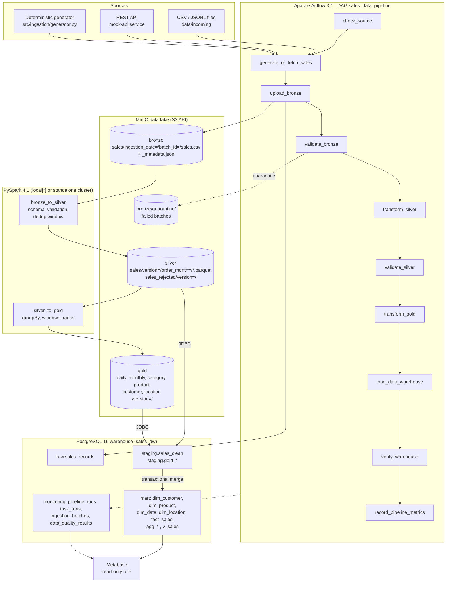

# Architecture

## Overview



Everything runs locally with `docker compose`; no cloud account is required. MinIO speaks the
Amazon S3 API, so the same code works against S3 by changing `S3_ENDPOINT_URL` and credentials.

## Components and responsibilities

| Component | Location | Responsibility |
|---|---|---|
| Configuration | `src/config/settings.py` | All settings from environment variables / `.env`; no secrets in code. |
| Generator | `src/ingestion/generator.py` | Streaming, seeded synthetic orders (1-4 line items), lifecycle updates, optional dirty test cases. |
| API source | `src/ingestion/api_source.py`, `mock_api.py` | Fetch `GET /sales?date=` with retries; canonical JSONL output so retries are byte-identical. |
| Validation contract | `src/validation/schema.py` | Single definition of columns, defaults, regexes and the 11 reject rules (ordered). |
| Pandas engine | `src/validation/pandas_rules.py`, `src/transformations/pandas_transforms.py` | Warehouse-only path, benchmark, reference implementation for parity tests. Exact integer-cent money. |
| Spark engine | `src/transformations/spark_jobs.py`, `spark_session.py` | Bronze->Silver->Gold with explicit schemas; S3A + JDBC configuration. |
| Object storage | `src/storage/object_store.py` | Upload/download/list/exists/metadata/checksum, Parquet read/write, versioned publish (pointer swap) and pruning. |
| Warehouse | `src/warehouse/*.py`, `sql/migrations`, `sql/warehouse/merge_mart.sql` | Versioned migrations, read-only role, COPY loaders, idempotent star-schema merge under an advisory lock. |
| Quality | `src/validation/quality.py` | Check results, gates (`DataQualityError`), SQL checks for the warehouse and Gold reconciliation. |
| Monitoring | `src/monitoring/metrics.py` | Run/task metrics, batch registry, quality results (autocommit so failures are kept). |
| Orchestration | `src/orchestration/lake_pipeline.py`, `airflow/dags/sales_data_pipeline.py` | One function per DAG task; the CLI runs the same functions sequentially. |
| Analytics | `sql/analytics/sales_kpis.sql`, `src/analytics/*` | KPI queries; Metabase provisioning (collection, 21 questions, 2 dashboards). |
| CLI | `src/cli.py` | `init`, `generate`, `ingest`, `lake-run`, `verify`, `report`, `lake-inspect`, `benchmark`, `provision-metabase`. |

## Docker Compose services

| Service | Image | Purpose | Host port (127.0.0.1) |
|---|---|---|---|
| `postgres` | postgres:16 | Warehouse `sales_dw` (raw, staging, mart, monitoring, legacy) | 5434 |
| `meta-postgres` | postgres:16 | Separate metadata DBs `airflow` and `metabase` | - |
| `minio` | chainguard/minio (digest-pinned) | S3-compatible lake + web console | 9000 API, 9001 console |
| `init` | sales-pipeline (project image) | One-shot: migrations, read-only role, buckets | - |
| `airflow-apiserver` | sales-pipeline | Airflow UI + REST + task execution API | 8080 |
| `airflow-scheduler` | sales-pipeline | Scheduling + LocalExecutor (tasks + Spark driver run here) | - |
| `airflow-dag-processor` | sales-pipeline | Parses DAG files | - |
| `metabase` | metabase/metabase:v0.64.5.5 | Dashboards (connects with `metabase_reader`) | 3000 |
| `mock-api` | sales-pipeline | Demo REST source | 8000 |
| `app` (profile `tools`) | sales-pipeline | `docker compose run --rm app ...` for CLI/tests | - |
| `spark-master`, `spark-worker` (profile `spark-cluster`) | sales-pipeline | Optional standalone Spark cluster | 8081 (master UI) |

**One image for all Python workloads** (`Dockerfile`, based on `apache/airflow:3.1.8-python3.12`, plus
OpenJDK 17, the S3A/JDBC JARs and the Airflow-constrained requirements). The Spark driver,
executors and Airflow workers therefore always share Python 3.12, Java 17, Spark 4.1.1 and
the same connector JARs — the most common source of PySpark-on-Docker failures (Python or
Hadoop version mismatch between driver and executors) is designed out.

### Version decisions

| Choice | Reason |
|---|---|
| Airflow 3.1.8 | Current major line (Airflow 2 reached end-of-life in 2026); a mature minor release rather than the newest 3.4. |
| PySpark 4.1.1 | Pinned by Airflow 3.1.8's constraint file, so it is guaranteed co-installable. |
| hadoop-aws 3.4.2 + AWS SDK v2 bundle 2.29.52 | Spark 4.1.1 is built with Hadoop 3.4.2; versions taken from the hadoop-project 3.4.2 POM. |
| PostgreSQL JDBC 42.7.14 | Current driver release. |
| pandas 2.3.3 / pyarrow 18.1.0 / boto3 1.42.61 | Airflow 3.1.8 constraints (not the newest releases, deliberately). |
| MinIO via Chainguard | Official community images are no longer published; Chainguard builds from source. Pinned by digest. |
| Metabase v0.64 LTS line | Long-term-support release. |

## Execution modes

1. **Lake mode (primary)** — Airflow DAG or `python -m src.cli lake-run`: Bronze/Silver/Gold in MinIO,
   Spark transformations, JDBC load into staging, transactional merge into the mart.
2. **Warehouse-only mode (Phase 1)** — `python -m src.cli ingest --input file.csv`: pandas validation
   and a single-transaction CSV -> raw -> staging -> mart load. Useful without MinIO/Spark and for the
   original starter files (legacy column layout is still accepted).

Both modes feed the same `staging.sales_clean` contract and the same guarded merge, so they can coexist:
a version can only replace a fact row if its `updated_at` is at least as new.

## Data flow and idempotency per layer

| Layer | Storage | Key | Re-run behaviour |
|---|---|---|---|
| Extract | `data/generated/...` | logical date | Generator is seeded per date; API output is canonicalised -> identical bytes. |
| Bronze | `bronze/sales/ingestion_date=D/batch_id=B/` | `B = "b" + sha256[:16]` of the file | Checksum lookup in `monitoring.ingestion_batches`; existing batch is reused, not re-uploaded. |
| Raw | `raw.sales_records` | `(batch_id, source_row)` | `ON CONFLICT DO NOTHING`. |
| Silver | `silver/sales/version=V/` + `_CURRENT.json` | `order_item_id` | Full recompute from all accepted Bronze batches into a new version; pointer swapped only after quality gate. |
| Gold | `gold/<table>/version=V/` + `_CURRENT.json` | table key | Same version/pointer pattern; reconciled against Silver revenue before publishing. |
| Warehouse | `mart.*` | `order_item_id` (facts), natural keys (dims) | Upsert with `source_updated_at <=` guard + `IS DISTINCT FROM` change detection; aggregates swapped atomically. |

### What happens when a source record changes after it was processed?

1. The new version arrives in a later batch (e.g. the 2026-03-02 extract contains a status change for
   an order placed on 2026-03-01) with a later `updated_at`.
2. It lands in Bronze as a new batch; nothing earlier is modified (Bronze is append-only).
3. Silver is recomputed from all batches; the window `row_number() over (partition by order_item_id
   order by updated_at desc, ingestion_date desc, batch_id desc, source_row_hash desc)` keeps exactly one
   current version. The superseded version is counted (`superseded_versions`).
4. The merge updates the existing fact row in place (same `sales_key`); a cancellation flips
   `order_status` so the revenue disappears from completed-sales reporting but the order still counts
   in total orders and the cancellation rate.
5. A *late, older* version (replayed file) can never overwrite a newer one, because of the
   `source_updated_at <= EXCLUDED.source_updated_at` guard.

## Reliability and safety

* **Quality gates:** `validate_bronze` (integrity, contract, per-batch reject rate),
  `validate_silver` (uniqueness, nulls, revenue formula, reconciliation, overall reject rate),
  Gold reconciliation, warehouse checks (orphans, duplicates, formula, snapshot coverage).
  Gates have `retries=0`: retrying does not fix bad data.
* **Quarantine:** a failed Bronze batch is moved to `bronze/quarantine/...` and marked `quarantined`,
  so it never poisons later Silver recomputes; failed rows go to `silver/sales_rejected/` and
  `staging.sales_rejected` / `data/rejected/*.csv`.
* **Concurrency:** `max_active_runs=1`, a `pipeline_writes` pool (1 slot) for all Spark/write tasks, and PostgreSQL advisory
  locks (`pg_advisory_lock` held across JDBC load + merge) prevent interleaved writers, including a
  CLI run started while Airflow is running.
* **Retries:** exponential back-off; each Silver/Gold attempt writes to its own version prefix
  (`<run_id>-t<try>`), so a half-written attempt is never published.
* **Failure handling:** `on_failure_callback` marks the run failed in `monitoring.pipeline_runs` and
  posts to `ALERT_WEBHOOK_URL` if configured.
* **Security:** all ports bound to `127.0.0.1`; secrets only in `.env` (git-ignored, generated by
  `scripts/setup_env.py`); Metabase uses `metabase_reader` (SELECT on `mart`/`monitoring` only,
  `default_transaction_read_only=on`, no access to `raw`/`staging`); parameterised SQL everywhere;
  DDL identifiers/literals built with `psycopg.sql`.

## Optional Spark standalone cluster

```bash
docker compose --profile spark-cluster up -d spark-master spark-worker
# then run any Spark step against the cluster, e.g.
docker compose run --rm --name sales-driver -e SPARK_MASTER=spark://spark-master:7077 \
    -e SPARK_DRIVER_HOST=sales-driver app python -m src.cli lake-run --date 2026-03-05
```

The master UI is at http://localhost:8081. Driver and executors use the same image, so Python and
JAR versions always match. `SPARK_DRIVER_HOST` must be a hostname the workers can resolve (the
container name) and **must not contain underscores** — executors reject
`spark://CoarseGrainedScheduler@sales_driver:port` as an invalid URL and the job waits forever
(observed during verification). For Airflow, set `SPARK_DRIVER_HOST=airflow-scheduler`. The S3A
and JDBC JARs are shipped to executors through `spark.jars`.
