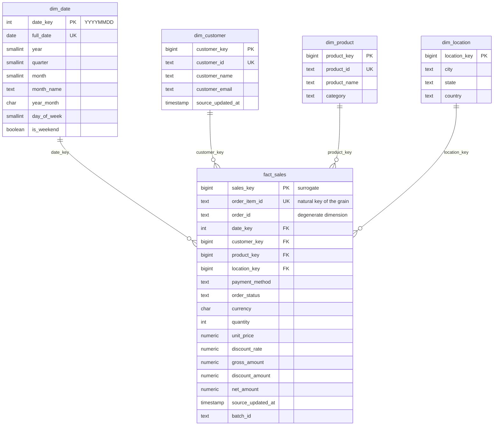

# Data model

## Source contract (Bronze)

One CSV/JSONL row per **order line item**. Columns (all received as text):

| Column | Required | Notes |
|---|---|---|
| `order_id` | yes | Order header id, e.g. `ORD-20260301-000042` |
| `order_item_id` | yes | **Natural key of the grain**, e.g. `ORD-20260301-000042-02` |
| `order_date` | yes | `YYYY-MM-DD` (also accepts `YYYY/MM/DD`, normalised) |
| `customer_id`, `customer_name` | yes | |
| `customer_email` | no | Lower-cased; invalid format -> NULL (not a rejection) |
| `product_id`, `product_name` | yes | |
| `category` | no | default `Uncategorized` |
| `quantity` | yes | integer 1..10,000 |
| `unit_price` | yes | >= 0, max 2 decimals, <= 99,999,999.99 |
| `discount` | no | rate 0..0.9 (e.g. `0.15` = 15 %), default 0 |
| `total_amount` | yes | must equal the recomputed net amount within 0.01 |
| `currency` | no | default `INR`; only `ALLOWED_CURRENCIES` accepted |
| `payment_method` | no | normalised; unknown values -> `unknown` |
| `order_status` | yes | `completed`, `pending`, `cancelled` (case-insensitive) |
| `city`, `state`, `country` | no | default `Unknown` |
| `updated_at` | yes | ISO timestamp (UTC); must not be before `order_date` |

Reject rules (a row lists *all* rules it fails, in this order): `missing_required_field`,
`invalid_order_date`, `invalid_updated_at`, `updated_before_order_date`, `invalid_quantity`,
`invalid_unit_price`, `invalid_discount`, `invalid_total_amount`, `total_amount_mismatch`,
`invalid_order_status`, `unsupported_currency`.

> The original Phase-1 layout (`transaction_id, transaction_date, ..., status`) is still accepted by the
> warehouse-only path: each transaction becomes an order with one line item (`order_item_id =
> transaction_id`), no discount, total derived.

## Revenue calculation

```
gross_amount    = quantity * unit_price
net_amount      = ROUND(quantity * unit_price * (1 - discount), 2)      -- ROUND_HALF_UP
discount_amount = gross_amount - net_amount
revenue         = SUM(net_amount) WHERE order_status = 'completed'
average order value = revenue / COUNT(DISTINCT order_id) of completed orders
cancelled order %   = cancelled orders / all orders * 100   (distinct order_id)
```

* pandas computes with **integer cents and basis points**
  (`(q * price_cents * (10000 - discount_bp) + 5000) // 10000`), Spark with `DECIMAL`, PostgreSQL with
  `NUMERIC` — all three give the identical half-up result (enforced by a `CHECK` constraint on
  `mart.fact_sales` and by the parity tests).
* Revenue is a **completed-sales** measure. Pending and cancelled line items stay in the fact table
  (needed for order counts, cancellation rate and auditability) but are filtered out of revenue.

## Star schema (mart)



### Grain

**`mart.fact_sales`: exactly one row per order line item (`order_item_id`).** Order-level facts
(order counts, AOV) are derived with `COUNT(DISTINCT order_id)`; `order_id` is kept on the fact as a
degenerate dimension. The current version of a line item is stored (status changes update the row).

### Keys

| Table | Primary key | Natural / unique key | Foreign keys |
|---|---|---|---|
| `dim_date` | `date_key` (smart key YYYYMMDD) | `full_date` | - |
| `dim_customer` | `customer_key` (identity) | `customer_id` | - |
| `dim_product` | `product_key` (identity) | `product_id` | - |
| `dim_location` | `location_key` (identity) | `(country, state, city)` | - |
| `fact_sales` | `sales_key` (identity) | `order_item_id` | `date_key`, `customer_key`, `product_key`, `location_key` |

Surrogate keys decouple the warehouse from source identifiers (ids can be recycled or re-formatted
by the source; joins on small integers are cheaper; SCD Type 2 becomes possible).
`dim_date` is pre-populated for 2020-2035 and extended on demand.

Indexes: every fact foreign key, `order_id`, `order_status`; unique indexes on natural keys.

### Slowly changing dimensions

* **Implemented: SCD Type 1** on `dim_customer` and `dim_product` — the most recent source version
  (by `updated_at`) overwrites name/email/category in place; the surrogate key never changes, so
  history is reported under the current name. The `source_updated_at` guard stops older data from
  overwriting newer attributes.
* **Optional SCD Type 2 enhancement** (not implemented, documented design):
  ```sql
  ALTER TABLE mart.dim_customer
      ADD COLUMN valid_from TIMESTAMP, ADD COLUMN valid_to TIMESTAMP DEFAULT 'infinity',
      ADD COLUMN is_current BOOLEAN DEFAULT TRUE;
  -- unique (customer_id) becomes unique (customer_id) WHERE is_current
  -- merge: when tracked attributes change -> UPDATE old row SET valid_to = new.updated_at,
  --        is_current = false; INSERT new row (new customer_key) with valid_from = new.updated_at
  -- facts: look up the customer_key whose [valid_from, valid_to) contains the order's updated_at
  ```
  Use it when reports must show attributes *as they were* at the time of the sale (e.g. customer
  segment or region at purchase time).

### Aggregate tables (Gold, loaded from the lake)

| Table | Grain | Columns (highlights) |
|---|---|---|
| `agg_daily_sales` | order_date | orders by status, units, gross/discount/net revenue, AOV, 7-day moving average, cumulative revenue |
| `agg_monthly_sales` | month | orders, revenue, AOV, previous-month revenue, growth %, cancelled % |
| `agg_category_sales` | category | completed orders, units, revenue, share %, rank |
| `agg_product_sales` | product | latest name/category, units, revenue, overall rank, rank within category |
| `agg_customer_sales` | customer | total/completed orders, lifetime revenue, first/last order date, rank |
| `agg_location_sales` | country/state/city | completed orders, distinct customers, revenue, rank |

`verify_warehouse` asserts that these reconcile exactly with the fact table.

## Other schemas

| Schema | Tables | Purpose |
|---|---|---|
| `raw` | `sales_records` | Every received row, untouched (TEXT), keyed by `(batch_id, source_row)`, with row hash. |
| `staging` | `sales_clean`, `sales_rejected`, `gold_*` | Validated snapshot feeding the merge; quarantined rows (JSONB); JDBC landing tables for Gold. |
| `mart` | dims, `fact_sales`, `agg_*`, views `v_sales`, `v_completed_sales` | Analytics (Metabase reads only this and `monitoring`). |
| `monitoring` | `pipeline_runs`, `task_runs`, `ingestion_batches`, `data_quality_results` | Operational metadata. |
| `legacy` | Phase-1 starter tables | Moved (not dropped) by migration V001. |
| `public` | `schema_migrations` | Applied migration versions + checksums. |

## Silver dataset (Parquet)

`silver/sales/version=<V>/order_month=YYYY-MM/part-*.parquet` with the columns of
`staging.sales_clean` (typed: `DATE`, `TIMESTAMP`, `DECIMAL(12,2)`, `DECIMAL(16,2)`, `DECIMAL(6,4)`,
`INT`). Partitioned by order month (one file per month — avoids small files at this volume) and
sorted by `order_item_id` inside each file for deterministic contents. Rejected rows:
`silver/sales_rejected/version=<V>/` with raw values plus `reject_reasons`.
