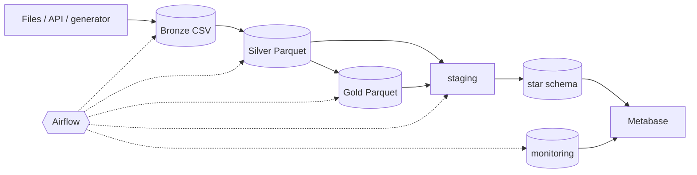

# Project overview — End-to-End Sales Data Engineering Pipeline

## Business problem

A retailer receives sales transactions every day as files, and potentially from an API. The data
is messy: duplicate rows, missing customer ids, impossible quantities, wrong totals and
inconsistent formats. Orders also change after they are placed, as pending orders complete and
completed orders get cancelled. The business needs trustworthy daily answers to questions like
*what is our completed revenue, which products and regions drive it, what share of orders is
cancelled, how is revenue trending month over month*, and the data team needs to know when the
pipeline or the data breaks.

## Solution

A local, fully containerised data platform that:

1. **Ingests** daily batches from files, a REST API or a deterministic generator, stores them
   untouched in a **Bronze** layer in MinIO (S3-compatible) with checksums and metadata, and lands
   every raw row in PostgreSQL.
2. **Validates and cleans** them with **PySpark**: 11 ordered rules, exact decimal revenue maths,
   deterministic latest-version-wins de-duplication, and row-level quarantine. The result is
   **Silver** Parquet, partitioned by month.
3. **Aggregates** **Gold** datasets: daily and monthly sales with moving averages and growth,
   category share, product and customer rankings, regional sales.
4. **Loads** a PostgreSQL **star schema** (order-line grain, 4 dimensions, SCD Type 1) through
   staging tables and one guarded, idempotent transactional merge.
5. **Orchestrates** everything with an **Airflow 3** DAG: daily data-interval schedule, backfills,
   retries, timeouts, quality gates, failure callback.
6. **Monitors** runs, tasks, batches and data-quality results in a `monitoring` schema.
7. **Serves** analytics in **Metabase** through a read-only account: a sales dashboard with
   filters and a pipeline-monitoring dashboard, both provisioned by API.

## Technologies

Python 3.12 · pandas · PySpark 4.1 (Java 17, S3A) · PostgreSQL 16 · MinIO · Apache Parquet ·
Apache Airflow 3.1 · Metabase · Docker Compose · pytest · psycopg 3 · boto3 · Mermaid.

## Architecture

See [ARCHITECTURE.md](ARCHITECTURE.md) and [DATA_MODEL.md](DATA_MODEL.md).

## Challenges and engineering decisions

| Challenge | Decision |
|---|---|
| Re-runs and retries must not duplicate data | Content-addressed batches (sha256), versioned Silver/Gold outputs published by pointer swap, guarded upserts (`source_updated_at <=` + `IS DISTINCT FROM`). Verified: a re-run changes 0 fact rows. |
| Records change after they were loaded | Every row carries `updated_at`; Silver keeps the latest version per `order_item_id` with a deterministic tie-breaker; cancellations update the fact in place, so revenue drops but the order still counts. |
| One bad delivery could block every future run | Batch-level quarantine: a batch that fails Bronze checks is moved to `bronze/quarantine/` and excluded from later recomputes. Row-level rejects go to quarantine tables and files with reasons. |
| Two engines (pandas and Spark) must agree | One contract module (`schema.py`) with rules in a fixed order. Integer-cent maths in pandas and DECIMAL in Spark both round half-up. Parity tests compare every Silver row, every reject reason and all six Gold tables. |
| Spark 4 ANSI mode fails jobs on one bad value | `try_cast` / `try_to_timestamp` around every risky cast, so bad values become reject reasons instead of failed jobs. |
| PySpark-in-Docker version drift | A single image for Airflow, Spark driver and executors, and CLI, built with the Airflow constraints file. Hadoop/AWS SDK JAR versions come from the Hadoop 3.4.2 POM. |
| MinIO stopped publishing community images | Switched to a digest-pinned, source-built Chainguard image (and fixed its healthcheck for an image without curl/grep). |
| Concurrent writers | `max_active_runs=1`, a 1-slot pool, and PostgreSQL advisory locks held across the JDBC staging load and the merge. |
| Least privilege for BI | `metabase_reader` can only read `mart` and `monitoring` and is forced read-only. Verified that `DELETE` and access to `raw` are refused. |
| Keep the Phase-1 starter working | Migration V001 moves the old tables into a `legacy` schema without dropping them. The old CSV layout is still accepted, and `python -m src.pipeline` / `src.generate_data` still work. |

## Results (measured in this environment)

Environment: Windows 11, Docker Desktop with a WSL2 VM showing 16 CPUs and 11.5 GiB RAM.

* **Tests:** 70 pytest tests pass inside the project image: unit tests plus integration tests
  against real PostgreSQL, MinIO and Spark, including the end-to-end lake pipeline and the DAG
  structure.
* **Idempotency:** re-running the same day reused the batch (`times_received = 2`), uploaded
  nothing and changed **0** fact rows; revenue and counts were identical.
* **Data quality:** a generated 1,029,722-row file with 2% injected defects produced 13,309
  rejected rows and 29,376 resolved duplicates or superseded versions. Pandas and Spark agreed
  exactly (987,037 Silver rows each).
* **Orchestration:** manual run, scheduled run, a 7-day backfill, an automatic retry after a
  simulated database outage (attempt 1 failed, attempt 2 succeeded), and a quality-gate failure
  that quarantined a malformed batch were all executed through Airflow. The first backfill revealed
  that Airflow 3 backfills ignore the DAG's `max_active_runs` (7 runs started together). This led to
  the `pipeline_writes` pool and the optimistic Silver publish guard.
* **Typical daily run** (about 1,000 new line items + updates, full Silver recompute over 1-2 weeks
  of history): about 145 s end to end in Airflow when runs are serialised. Each Spark task starts
  its own JVM there. The CLI (`lake-run --days N`) reuses one Spark session and processed 28 days
  of February in 10 min 14 s (about 22 s per day).
* **Benchmark** (warm, best of repeated runs; see [benchmark_results.md](benchmark_results.md)):

  | Clean records | pandas | PySpark `local[*]` |
  |---:|---:|---:|
  | 10,000 | 0.63 s | 13.30 s |
  | 100,000 | 4.22 s | 20.96 s |
  | 1,000,000 | 39.92 s | 52.66 s |

  On a single machine pandas was faster at every size tested. Spark's fixed overhead (JVM,
  scheduling, shuffles, Parquet commit) dominates small inputs, and the gap shrinks from about 21×
  at 10k rows to about 1.3× at 1M rows. Pandas' peak memory grew to 2.8 GB at 1M rows on an
  11.5 GiB VM; Spark processes partitions in a bounded heap and can scale out to a cluster, which
  is what it is for. No crossover point was measured on this host.

## Future enhancements

* Incremental Silver with an ACID table format (Apache Iceberg or Delta Lake `MERGE`) instead of
  a full recompute.
* SCD Type 2 for customer attributes (design in DATA_MODEL.md).
* CI pipeline (GitHub Actions) running the Docker-based test suite; pre-commit linting.
* OpenLineage / Marquez for lineage; Great Expectations or Soda for declarative checks.
* Kubernetes deployment (Spark on K8s, KubernetesExecutor), a secrets manager and TLS.
* Multi-currency support with daily FX rates.
* Streaming ingestion (Kafka + Spark Structured Streaming) for near-real-time dashboards.
